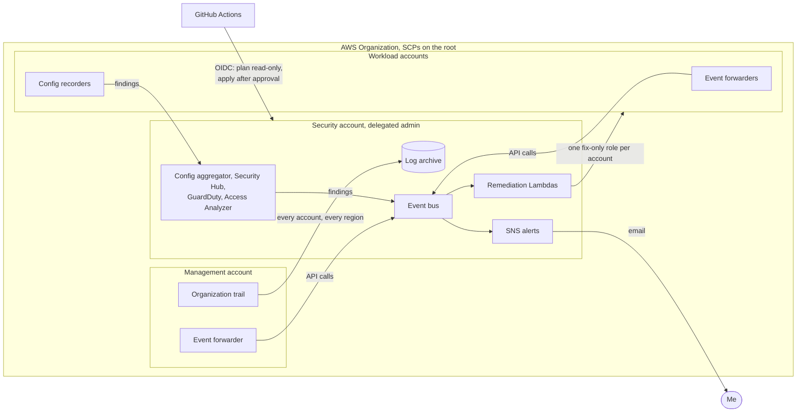

# AWS Security Guardrails

Guardrails for a four-account AWS Organization: the management account, a security account that runs every security service for the rest, and two workload accounts from my earlier projects. Service control policies stop the worst mistakes before they happen, CloudTrail, Config, Security Hub, GuardDuty and Access Analyzer see what gets through, and Lambda functions fix three kinds of problems in seconds and email me about the rest. All of it is Terraform, deployed by GitHub Actions without stored keys, and every control below was triggered on purpose at least once.

## Stack

- AWS Organizations: SCPs, delegated administration, Identity Center
- Detection: an organization CloudTrail with log file validation, AWS Config with organization rules, Security Hub (CIS 3.0, AWS Foundational Security Best Practices, NIST 800-53 rev5), GuardDuty and IAM Access Analyzer
- Response: EventBridge, SNS and Python Lambdas, tested with pytest and moto
- Pipeline: GitHub Actions with OIDC, Checkov, TFLint, Conftest (Rego) on every plan, Access Analyzer policy validation, Gitleaks
- Infrastructure: Terraform, one state per layer in an encrypted S3 bucket

## How it works

The security account is the delegated administrator for Config, Security Hub, GuardDuty and Access Analyzer, so findings from every account land there. The organization trail writes to a log archive in that account, and not even its own admin can change the logs.

1. Prevent: SCPs on the organization root deny every region except us-east-1, any action by a member account's root user, leaving the organization, and turning off or editing the trail, the log archive, the recorders, the security services and the alerting.
2. Detect: Config records every account and five organization rules flag open SSH, public buckets, a missing trail, keys without rotation and missing tags. Security Hub checks three standards and collects GuardDuty and Access Analyzer findings.
3. Correct: each account forwards the API calls I care about to the security account's event bus. Three Lambdas close SSH or RDP open to the world, turn S3 Block Public Access back on and restart a stopped trail. Five other kinds of events send me an email.
4. Change: a pull request gets a read-only plan of every stack, checked by Conftest and Access Analyzer. A merge to `dev` applies only after I approve it in GitHub.

[docs/architecture.md](docs/architecture.md) has the details.

<details>
<summary>The architecture as a Mermaid diagram</summary>



</details>

## Failures tested on purpose

| What was broken | What caught it |
|---|---|
| An admin of a member account using another region, or trying to leave the organization | [The SCPs](docs/evidence/scp-guardrails.md) |
| The security account's admin editing the log archive, then a log file edited by the one role that can | [The bucket policy, the SCP and log file validation](docs/evidence/log-tampering.md) |
| A security group and a tag changed by hand in the console | [Config, then Terraform](docs/evidence/config-drift.md) |
| RDP opened to the world, S3 Block Public Access turned off, the organization trail stopped | [The remediation Lambdas, in 9 to 13 seconds](docs/evidence/automated-remediation.md) |
| A new access key, GuardDuty findings and a bucket shared outside the organization | [Email alerts](docs/evidence/security-alerts.md) |
| A pull request that stops the trail and removes its SCP statement | [Conftest on the plan](docs/evidence/pipeline-policy-gate.md) |
| The pipeline creating itself an admin role | [A permissions boundary](docs/evidence/least-privilege-pipeline.md) |

## Security

People sign in through IAM Identity Center and the pipeline through OIDC, so there are no access keys anywhere. Pull requests plan through read-only roles that can't read data, and applies go through a management role that can only create roles capped by a permissions boundary. The roles the pipeline uses live in a stack that only a person applies, so a merged change can't widen them. The repository and its Actions logs are public, so every job masks the account IDs and emails before Terraform runs. The [threat model](docs/threat-model.md) covers what's still exposed and why.

## Design choices

- The log archive lives in the security account instead of its own account. It's cheaper and simpler here, and it's the first thing I'd split in production.
- Security Hub uses central configuration: one policy on the organization root, with 16 controls disabled and a written reason for each, instead of settings per account.
- GuardDuty runs foundational detection only. The paid protection plans would cost more than everything else together.
- Only three problems are fixed automatically, the ones where the fix is safe and obvious. Everything else is an email, because a wrong automatic fix can cause an outage.
- Checkov reads the code and Conftest reads the plan, which is the only place you can see a replace hiding a delete or a statement disappearing from an SCP.
- Everything ran in us-east-1 only, and the region deny SCP enforces that.

## What would change in production

- A separate log archive account, and a second approver who isn't the author of the change
- A narrowed deploy role in each member account instead of `OrganizationAccountAccessRole`
- Findings in a SIEM or Security Lake and alerts that page someone, not email
- More regions with cross-region aggregation, plus Inspector and Macie
- Permission sets per job in Identity Center and a written break-glass procedure

## Running it

The bootstrap stack goes first, applied by a person with SSO, and the other four stacks follow in order. After that, changes go through pull requests. The [deployment guide](docs/deployment.md) has the steps, including the teardown.

```bash
pip install -r requirements-dev.txt
pytest
```

## Repository

```text
infra/bootstrap   State bucket and the pipeline's own roles, applied by a person
infra/org         Organization, OUs, SCPs, delegated admins and budget
infra/logging     Organization trail, log archive and Config bucket
infra/baseline    Recorders, hardening, forwarders and roles in every account
infra/security    Config rules, Security Hub, GuardDuty, Access Analyzer, alerts, remediation
infra/modules     Modules used once per account
lambdas/          Remediation functions in Python
policy/           Conftest policies for Terraform plans
scripts/          Policy validation and a one-off cleanup script
docs/             Architecture, threat model, deployment guide and evidence
```

## Status

A practice project, last updated on October 23, 2026. It isn't maintained, so the pinned versions and image digests will fall behind; update them before reusing any of it. Everything in AWS was destroyed when the project ended, so the workflows that need AWS no longer run.

AI assistants sped up the writing, the same way they do in my day-to-day work. The decisions and trade-offs were mine, and I can explain what any part of this does and why.
